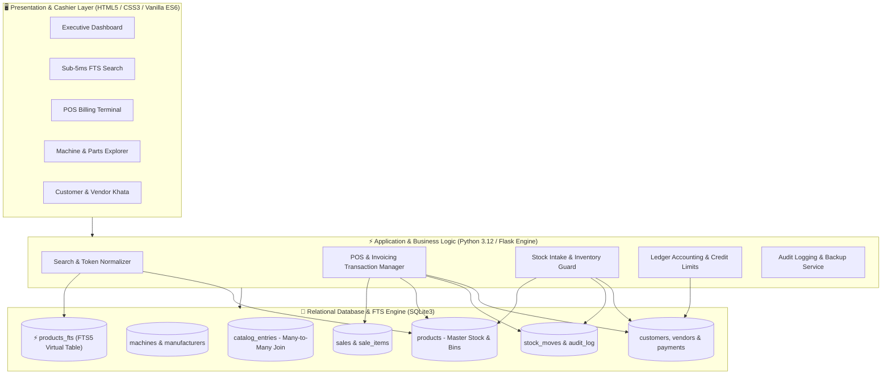
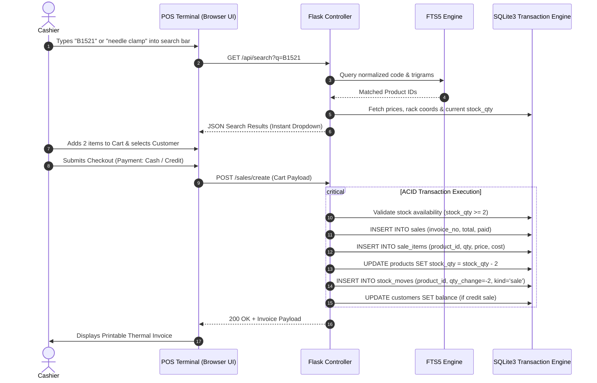

# Spare Parts Management & Sales System

<div align="center">
  
  <br/>
  <h3>Enterprise Inventory, Multi-Machine Compatibility Cross-Referencing & POS Ledger System</h3>
  <p><em>A specialized, offline-first business management platform engineered for industrial textile and garment machinery spare parts retail, distribution, and financial accounting.</em></p>

  <p>
    <a href="#-system-architecture"></a>
    <a href="#-technology-stack"></a>
    <a href="#-machinery--parts-catalog-statistics"></a>
    <a href="#-project-status"></a>
  </p>
</div>

---

## 📑 Table of Contents
- [Executive Overview](#-executive-overview)
- [Business Problem & Industry Challenges](#-business-problem--industry-challenges)
- [The Engineering Solution](#-the-engineering-solution)
- [Core Functional Modules](#-core-functional-modules)
- [Machinery & Parts Catalog Statistics](#-machinery--parts-catalog-statistics)
- [Visual Interface Walkthrough & Technical Details](#-visual-interface-walkthrough--technical-details)
  - [1. Executive Central Dashboard](#1-executive-central-dashboard)
  - [2. Sub-5ms Instant Full-Text Search](#2-sub-5ms-instant-full-text-search)
  - [3. Machine Catalog & Sub-Assembly Explorer](#3-machine-catalog--sub-assembly-explorer)
  - [4. Single Part Profile & Cross-Machine Matrix](#4-single-part-profile--cross-machine-matrix)
  - [5. Rapid Point of Sale (POS) Cashier Terminal](#5-rapid-point-of-sale-pos-cashier-terminal)
  - [6. Sales Invoicing & Order Lifecycle Management](#6-sales-invoicing--order-lifecycle-management)
  - [7. Stock Intake & Procurement Workflow](#7-stock-intake--procurement-workflow)
  - [8. Customer Credit Ledger (Khata) & Receivables](#8-customer-credit-ledger-khata--receivables)
  - [9. Vendor Procurement & Payables Ledger](#9-vendor-procurement--payables-ledger)
- [System Architecture & Data Modeling](#-system-architecture--data-modeling)
- [End-to-End Operational Workflows](#-end-to-end-operational-workflows)
- [Technology Stack Matrix](#-technology-stack-matrix)
- [Key Engineering Highlights & Algorithms](#-key-engineering-highlights--algorithms)
- [Role & Engineering Contributions](#-role--engineering-contributions)
- [Project Status](#-project-status)
- [Proprietary Notice & Privacy Policy](#-proprietary-notice--privacy-policy)

---

## 🌟 Executive Overview

The **Spare Parts Management & Sales System** is an offline-first commercial desktop platform designed to eliminate the massive friction in industrial machinery spare parts retail. 

Operating in an industry characterized by complex equipment (overlock machines, lockstitchers, interlock coverstitchers, automated bartackers, and cutting units), the software serves as the central operational backbone—unifying **25,299 unique spare parts**, **76,987 machine diagram cross-references**, and **41 heavy industrial machine models** across **14 international manufacturers**.

It seamlessly integrates technical OEM parts manuals with real-time shop-floor retail workflows: instant symbol-agnostic catalog search, bin and rack physical warehouse navigation, rapid Point-of-Sale (POS) invoicing, and automated double-entry customer/vendor credit accounting (*Khata*).

---

## 🛑 Business Problem & Industry Challenges

Industrial spare parts distribution is plagued by operational complexities that conventional generic POS/ERP systems cannot handle:

1. **Extreme Cross-Machine Compatibility**:
   - A single standardized industrial part (e.g., a specific needle clamp, looper thread guide, or presser foot screw) is frequently shared across 5 to 15 distinct machine models and multiple schematic sections.
   - *Traditional Failure Mode*: Standard inventory software forces shops to create duplicate records per machine model, causing phantom inventory, fractured stock levels, and severe stock reconciliation errors.
2. **Search Latency & Customer Counter Bottlenecks**:
   - Customers request parts under different variations: OEM catalog numbers (`B1521-555-000`), punctuation-stripped numbers (`B1521555000`), machine model references (`Juki DDL-8700 needle bar`), or colloquial Urdu/English vernacular names.
   - *Traditional Failure Mode*: Cashiers manually browse through thick, multi-hundred-page paper parts books while customers wait, leading to long queues and lost transactions.
3. **Dual Identity of Parts (Catalog vs. Physical Stock)**:
   - Parts possess two distinct sets of metadata:
     - **OEM Engineering Data**: Schematic reference number, section name (e.g., "Needle Bar Mechanism"), diagram page, and manufacturer catalog quantities.
     - **Shop Operational Data**: Physical warehouse coordinates (`Rack B-04`, `Bin 12`), local purchase cost, tiered sale prices, vendor source, and vernacular descriptions.
4. **Credit Accounting (*Khata*) & Offline Operational Reality**:
   - Commercial industrial retail runs heavily on credit relationships. Payments are made in partial installments, requiring continuous ledger balancing and credit limit tracking.
   - Cloud-dependent SaaS solutions introduce catastrophic downtime risks during internet outages in wholesale markets.

---

## 💡 The Engineering Solution

```
┌───────────────────────────────────────────────────────────────────────────────────────┐
│                           THE UNIFIED ARCHITECTURAL SOLUTION                          │
├───────────────────────────────┬───────────────────────────────┬───────────────────────┤
│    Catalog Blueprint Layer    │    Physical Inventory Layer   │  Financial & POS Layer│
│  (Many-to-Many Cross Mappings)│   (Unique Physical Stock Bin) │  (Real-Time Balances) │
├───────────────────────────────┼───────────────────────────────┼───────────────────────┤
│ • 14 Global Manufacturers     │ • Unified Part Code Key       │ • <50ms POS Checkout  │
│ • 41 Industrial Machine Books │ • Warehouse Rack Coordinates  │ • Atomic Stock Deduct │
│ • 76,987 Diagram Mappings     │ • Live On-Hand Quantity       │ • Customer Khata Book │
│ • Exploded Schematic Ref #s   │ • Safety Reorder Alerts       │ • Vendor Payables Log │
│ • PDF Page & Section Guides   │ • Weighted Unit Cost History  │ • Audit Trail Logging │
└───────────────────────────────┴───────────────────────────────┴───────────────────────┘
```

The system addresses these domain requirements by:
- **Decoupling Blueprint Data from Physical Stock**: Implementing a clean relational many-to-many bridge (`catalog_entries`) connecting machines to unified product stock bins. One single physical bin of screws serves every compatible machine automatically.
- **Sub-5ms Symbol-Agnostic FTS5 Search**: An indexed full-text engine tokenizing codes and names into alphanumeric normalized keys (`normalize_code()`), allowing instant fuzzy and punctuation-independent retrieval.
- **Zero-Latency Standalone Architecture**: Packaged as an offline-first Windows desktop executable using an embedded high-performance SQLite engine with zero internet dependency and automated backup routines.

---

## ⚙️ Core Functional Modules

- **🔍 Intelligent Multi-Parametric Search**: Search by full/partial part codes, manufacturer, machine model, section title, or vernacular part names with sub-millisecond response.
- **📚 Interactive Machinery Catalog**: Browse all 41 industrial machines hierarchically by brand, model, sub-assembly section, and schematic reference number.
- **⚡ High-Throughput Point-of-Sale**: Keyboard-driven checkout workflow with live stock checks, price overrides, customizable line discounts, and thermal receipt generation.
- **📦 Warehouse & Rack Location Engine**: Binds every inventory item to exact physical warehouse coordinates (`Rack`, `Row`, `Bin`) for immediate retrieval.
- **📒 Customer Ledger & Credit Khata**: Real-time customer balance calculations, credit limit enforcement, partial payment logging, and balance statements.
- **🚚 Vendor Procurement & Payables**: Supplier consignment intake, weighted average cost updates, and payment reconciliation.
- **🚨 Stock Movement & Audit Logging**: Immutable chronological event logging for stock movements (`sale`, `purchase`, `adjustment`, `return`) and master price modifications.

---

## 📊 Machinery & Parts Catalog Statistics

The platform manages an extensive industrial catalog comprising **25,299 unique products** and **76,987 machine-to-part cross-reference mappings** across **41 machine models** from **14 manufacturers**:

### Summary Metrics
| Metric | Count / Benchmark |
| :--- | :--- |
| **Total Equipment Manufacturers** | **14 Global Brands** |
| **Total Industrial Machine Models** | **41 Dedicated Models** |
| **Total Unique Spare Parts** | **25,299 Parts** |
| **Active Cataloged Inventory** | **24,054 Products** |
| **Total Machine-to-Part Mappings** | **76,987 Cross-References** |
| **Average Query Retrieval Speed** | **< 5 ms** |

### Complete Machine & Parts Breakdown Table
| Manufacturer | Machine Model | Cataloged Parts | Industrial Machine Category / Function |
| :--- | :--- | :---: | :--- |
| **Yamato** | `VG2700` | **4,820** | High-speed Cylinder Bed Interlock Stitch Machine |
| **Pegasus** | `L32 / L52` | **4,167** | High-speed Overlock / Safety Stitch Machine |
| **Pegasus** | `EX3200 / EX5200` | **3,902** | Advanced High-Speed Overedger Series |
| **Juki** | `LK-1900B` | **3,792** | Computer-controlled High-speed Bartacking Machine |
| **Juki** | `LH-3528` | **3,736** | Semi-Dry-Head 2-Needle Lockstitch Machine |
| **Brother** | `LH4-B814 MKII` | **3,629** | Lockstitch Buttonholer Machine |
| **Juki** | `LK-1850` | **3,229** | High-Speed Bartacking Machine |
| **Pegasus** | `W500 Series` | **3,173** | Flatbed Interlock / Coverstitch Machine Series |
| **Yamato** | `VC2700` | **3,029** | Cylinder Bed Interlock Stitch Machine |
| **Juki** | `LH-3168` | **2,845** | 2-Needle Lockstitch Machine with Large Hooks |
| **Zoje** | `ZJC2500` | **2,330** | High-speed Interlock Sewing Machine |
| **Pegasus** | `M732 / M752 (M700)` | **2,260** | Integrated High-Speed Overedger Series |
| **Generic** | `DCM-204` | **2,113** | Heavy Duty Industrial Lockstitch Machine |
| **Juki** | `LH-3128` | **1,920** | 2-Needle Lockstitch Machine |
| **Juki** | `DDL-9000B` | **1,914** | Direct-drive High-speed 1-Needle Lockstitch |
| **Brother** | `S-7200A` | **1,758** | Direct Drive Single Needle Lockstitcher |
| **Brother** | `KE-430H` | **1,755** | Electronic Direct Drive Lockstitch Bartacker |
| **Juki** | `DDL-900` | **1,743** | High-speed 1-Needle Lockstitch Machine |
| **Brother** | `KE-430FXII` | **1,674** | Electronic Programmable Lockstitch Bartacker |
| **Juki** | `MB-372 / MB-373` | **1,630** | Single-thread Chainstitch Button Sewing Machine |
| **Kingtex** | `CT4600` | **1,602** | High-speed Cylinder Bed Interlock Machine |
| **Brother** | `S-7300A` | **1,564** | Nexio Direct Drive Lockstitch Machine |
| **Eastman** | `Blue Streak` | **1,446** | Straight Knife Cloth Cutting Machine |
| **Brother** | `S-7100A` | **1,438** | Direct Drive Single Needle Lockstitch Machine |
| **Juki** | `DDL-8700-7` | **1,360** | 1-Needle Lockstitch with Automatic Thread Trimmer |
| **Juki** | `LBH-761 / 762 / 763` | **1,319** | 1-Needle Lockstitch Buttonholing Machine |
| **Kansai Special**| `B9500` | **1,310** | High-speed Feed-up-the-arm Interlock Machine |
| **Zoje** | `ZJ7000E` | **1,260** | Direct Drive Overlock Sewing Machine |
| **Newlong** | `NP-7A` | **1,221** | Portable Bag Closer Sewing Machine |
| **Juki** | `LBH-1790` | **1,211** | Computer-controlled High-speed Buttonholing |
| **Juki** | `DDL-8700 Series` | **1,119** | Standard 1-Needle Lockstitch Machine |
| **Juki** | `LK-1900` | **1,077** | Computer-controlled High-speed Bartacking Machine |
| **Siruba** | `700K / 700KD` | **1,006** | High-Speed Overlock Machine Series |
| **Pegasus** | `M900 Series` | **866** | Ultra High-Speed Overlock Machine Series |
| **Siruba** | `700F` | **839** | Super High-Speed Overedger |
| **Juki** | `MH-380` | **834** | High-speed Flatbed 2-Needle Chainstitch |
| **Juki** | `LBH-781/782/783/784`| **768** | Lockstitch Buttonholing Machine Series |
| **Juki** | `DDL-555-4` | **757** | 1-Needle Lockstitch Machine with Trimmer |
| **BS** | `BS-101` | **357** | Industrial Blindstitch Machine |
| **KM** | `KS-AU` | **177** | Vertical Cloth Cutting Machine |
| **Arrow** | `CM11` | **37** | Portable Blindstitch Machine |

---

## 📸 Visual Interface Walkthrough & Technical Details

Below is a detailed examination of the user interfaces, accompanied by screenshots, highlighting the business utility, UI workflows, and backend engineering implementations.

---

### 1. Executive Central Dashboard

<div align="center">
  
</div>

#### 📋 Business Purpose & Workflow
The central command console providing cashiers and store managers with an immediate snapshot of daily business health. It aggregates total cataloged parts, active stock values, low inventory alerts, today's sales revenue, and outstanding customer Khata receivables into responsive KPI cards.

#### 🔧 Technical & Architectural Implementation
- **Fast Metric Aggregation**: Queries pre-indexed summary views in SQLite with sub-10ms rendering time.
- **Quick Action Hub**: Single-keystroke navigation to Point-of-Sale (`POS`), Universal Search, Stock Inward, and Customer Accounts.
- **Low-Stock Notification Badge**: Dynamically highlights products whose `stock_qty <= min_level`.

---

### 2. Sub-5ms Instant Full-Text Search

<div align="center">
  
</div>

#### 📋 Business Purpose & Workflow
Enables shop counter staff to locate any spare part in under a second while attending customers. Staff can enter raw part numbers, fragmented codes, model names, or Urdu/English terms (e.g., `tension disc`, `bobbincase`, `looper`). The interface displays physical rack locations, live stock counts, pricing, and compatible machine models.

#### 🔧 Technical & Architectural Implementation
- **SQLite FTS5 Trigram Engine**: Leverages virtual full-text search tables synchronized via SQLite triggers.
- **Separator-Free Code Key Tokenization**: The backend applies `normalize_code(code)` to strip all hyphens, slashes, and periods into an uppercase alphanumeric key (`B1521-555-000` -> `B1521555000`), allowing matches regardless of input format.
- **Cross-Compatibility Counter**: Displays an interactive badge indicating how many machine models share the part.

---

### 3. Machine Catalog & Sub-Assembly Explorer

<div align="center">
  
</div>

#### 📋 Business Purpose & Workflow
Allows technicians and mechanics to browse industrial machinery catalogs organized by brand (Juki, Brother, Pegasus, Yamato, etc.) and model. Selecting a machine reveals all corresponding schematic sub-assemblies (e.g., *Needle Bar & Thread Take-up Mechanism*, *Feed Dog Assembly*, *Hook Driving Shaft*), exploded diagram reference numbers, and original catalog pages.

#### 🔧 Technical & Architectural Implementation
- **Relational Many-to-Many Traversal**: Queries `machines` joined with `catalog_entries` and `products`.
- **Schematic Reference Mapping**: Retains exact OEM reference numbers (Ref #) and PDF page indexes for visual verification against paper manuals.
- **Section Grouping & Filtering**: Dynamic server-side pagination and grouping to handle machines with over 4,800 mapped parts smoothly.

---

### 4. Single Part Profile & Cross-Machine Matrix

<div align="center">
  
</div>

#### 📋 Business Purpose & Workflow
The comprehensive master record of a single spare part. Displays dual metadata: OEM engineering specs (original name, code, manufacturer) and physical shop data (rack coordinates, custom name, unit purchase cost, selling price, current stock, and safety threshold). Crucially, it displays an interactive table of every machine model compatible with this part.

#### 🔧 Technical & Architectural Implementation
- **Single-Source Inventory Integrity**: Updates to stock, rack, or price propagate instantly to all machine associations without data redundancy.
- **Compatibility Cross-Join Query**: 
  ```sql
  SELECT m.model, mf.name as manufacturer, ce.section, ce.ref_number, ce.pdf_page
  FROM catalog_entries ce
  JOIN machines m ON ce.machine_id = m.id
  JOIN manufacturers mf ON m.manufacturer_id = mf.id
  WHERE ce.product_id = ?;
  ```
- **Live Stock Indicator & Edit Triggers**: Allows on-the-fly rack updates and price adjustments with automatic audit log recording.

---

### 5. Rapid Point of Sale (POS) Cashier Terminal

<div align="center">
  
</div>

#### 📋 Business Purpose & Workflow
Designed for rapid checkout during peak shop hours. Cashiers search parts directly inside the POS screen, add items to the dynamic cart, adjust quantities, apply item-level or bill-level discounts, and select the customer. Supports one-click payment mode toggling (Cash, Customer Khata Credit, or Bank Deposit).

#### 🔧 Technical & Architectural Implementation
- **Vanilla JavaScript Reactive Cart**: Zero-dependency client-side cart calculation with instant total, tax, and discount computations.
- **Customer Balance HUD**: Selecting an account customer immediately displays their current outstanding ledger balance and credit limit.
- **Stock Guard Validation**: Visual warnings prevent cashier from selling items exceeding available stock in hand.

---

### 6. Sales Invoicing & Order Lifecycle Management

<div align="center">
  
</div>

#### 📋 Business Purpose & Workflow
A central register of all completed customer transactions. Provides instant search by invoice number, customer name, date range, or payment type. Cashiers can reprint formatted 80mm thermal receipts or full-page A4 invoices and perform invoice revisions or returns.

#### 🔧 Technical & Architectural Implementation
- **Atomic Stock Reversal Engine**: When modifying or cancelling an invoice, the system automatically restores deducted inventory, creates audit log entries, and recalculates the customer's ledger balance.
- **Printable CSS Media Queries**: Native browser print styling formatted for standard ESC/POS thermal receipt printers and desktop printers without third-party drivers.

---

### 7. Stock Intake & Procurement Workflow

<div align="center">
  
</div>

#### 📋 Business Purpose & Workflow
The receiving dock interface used when new spare parts shipments arrive from manufacturers or distributors. The storekeeper selects the vendor, enters the consignment bill number, and logs received quantities alongside new unit purchase costs.

#### 🔧 Technical & Architectural Implementation
- **Batch Transaction Inward**: Executes multi-item stock increments within a single ACID database transaction.
- **Cost Averaging & Inventory Update**: Automatically updates `products.stock_qty` and records weighted `purchase_price`.
- **Vendor Ledger Synchronization**: Automatically posts a payable credit entry into the selected vendor's ledger account.

---

### 8. Customer Credit Ledger (Khata) & Receivables

<div align="center">
  
</div>

#### 📋 Business Purpose & Workflow
Comprehensive ledger accounting for customer credit accounts. Tracks running balances, credit limits, chronological purchases, cash collections, bank transfers, and balance settlements. Provides quick payment recording with instant ledger receipt generation.

#### 🔧 Technical & Architectural Implementation
- **Double-Entry Balance Verification**: Computes real-time balances using `Opening Balance + Total Invoiced Sales - Total Payments Recorded`.
- **Credit Limit Guardrails**: Warns operators when a customer's total unpaid balance approaches or exceeds their defined credit ceiling.
- **Date-Filtered Ledger Export**: Formats chronological statement summaries for customer accounts.

---

### 9. Vendor Procurement & Payables Ledger

<div align="center">
  
</div>

#### 📋 Business Purpose & Workflow
Dedicated supplier accounting module recording all inventory purchases, returns, advance payments, and outstanding payables across all manufacturing and wholesale vendors.

#### 🔧 Technical & Architectural Implementation
- **Supplier Liability Tracking**: Automatically increments liabilities upon stock intake and decrements them upon recording vendor payment disbursements.
- **Procurement History Breakdown**: Inspects historical purchase orders, unit prices, and delivered batch quantities per supplier.

---

## 🏗️ System Architecture & Data Modeling

The system is architected as a modular, three-tier desktop application optimized for reliability and zero latency:



### Relational Entity-Relationship Diagram (ERD)

```
┌─────────────────────┐          ┌─────────────────────┐          ┌─────────────────────┐
│    manufacturers    │1        *│      machines       │1        *│   catalog_entries   │
├─────────────────────┼──────────┼─────────────────────┼──────────┼─────────────────────┤
│ id (PK)             │          │ id (PK)             │          │ id (PK)             │
│ name                │          │ manufacturer_id(FK) │          │ product_id (FK) ────┼──┐
└─────────────────────┘          │ model               │          │ machine_id (FK)     │  │
                                 │ source_file         │          │ ref_number          │  │
                                 └─────────────────────┘          │ section             │  │
                                                                  │ pdf_page            │  │
                                                                  └─────────────────────┘  │
                                                                                           │
┌─────────────────────┐          ┌─────────────────────┐                                   │
│       vendors       │1        *│      products       │*                                 1│
├─────────────────────┼──────────┼─────────────────────┼───────────────────────────────────┘
│ id (PK)             │          │ id (PK)             │
│ name                │          │ manufacturer_id(FK) │          ┌─────────────────────┐
│ phone               │          │ vendor_id (FK)      │1        *│     sale_items      │
│ opening_balance     │          │ part_code           ├──────────┼─────────────────────┤
└─────────────────────┘          │ code_key (Indexed)  │          │ id (PK)             │
                                 │ custom_name         │          │ sale_id (FK)        │
                                 │ rack (Location)     │          │ product_id (FK)     │
                                 │ stock_qty, min_level│          │ qty, price, cost    │
                                 │ purchase/sale_price │          └─────────────────────┘
                                 └─────────────────────┘                     │*
                                            │1                               │
                                            │*                               │1
                                 ┌─────────────────────┐          ┌─────────────────────┐
                                 │     stock_moves     │          │        sales        │
                                 ├─────────────────────┤          ├─────────────────────┤
                                 │ id (PK)             │          │ id (PK)             │
                                 │ product_id (FK)     │          │ invoice_no (Unique) │
                                 │ qty_change, kind    │          │ customer_id (FK)    │
                                 │ unit_cost, date     │          │ subtotal, discount  │
                                 └─────────────────────┘          │ total, paid_amount  │
                                                                  └─────────────────────┘
```

---

## 🔄 End-to-End Operational Workflows

### 1. POS Sale & Inventory Deduct Transaction Cycle



---

## 💻 Technology Stack Matrix

| Layer / Domain | Technology Choice | Engineering Rationale & Implementation |
| :--- | :--- | :--- |
| **Backend Framework** | **Python 3.12 / Flask** | High-performance, lightweight WSGI server architecture with rapid request execution and Jinja2 templates. |
| **Database Engine** | **SQLite3 (ACID Embedded)** | Zero-configuration, serverless relational database offering robust multi-table transactions and low memory footprint. |
| **Full-Text Search** | **SQLite FTS5 Virtual Tables** | Trigram and prefix-tokenized indexing delivering sub-5ms query resolution over 25,000+ items. |
| **Token Normalization**| **Regex / Custom Tokenizer** | Neutralizes hyphens, slashes, and spaces to support robust symbol-agnostic lookups (`normalize_code()`). |
| **Frontend UI/UX** | **HTML5, CSS3, Vanilla JS** | Lightweight, responsive, keyboard-driven POS interface with zero external framework runtime overhead. |
| **Desktop Distribution**| **PyInstaller + Inno Setup** | Packaged into a standalone Windows installer (`.exe`) with auto-start batch routines and embedded SQLite storage. |
| **Security & Integrity**| **Hardware Node-Locking** | Machine-fingerprinted licensing mechanism and immutable audit trail logging. |

---

## 💡 Key Engineering Highlights & Algorithms

1. **Many-to-Many Catalog Separation**:
   Eliminated duplicate inventory records across 41 industrial machine catalogs by introducing the `catalog_entries` normalization bridge. One physical bin of screws in `Rack A-02` now automatically links to 12 different machine schematics.
2. **Separator-Free Code Key Search**:
   Industrial part numbers are inconsistent across manufacturers (e.g., `B1521-555-000`, `B1521.555.000`, `B1521 555 000`). The system automatically indexes an alphanumeric key `B1521555000` via automated triggers, ensuring 100% search accuracy regardless of punctuation.
3. **Atomic Financial & Stock Transactions**:
   All stock deductions, invoice insertions, ledger balance updates, and stock move records are executed inside atomic `BEGIN ... COMMIT` database transactions to prevent partial writes during system interruptions.
4. **Air-Gapped Offline-First Reliability**:
   Engineered to run seamlessly without an active internet connection, featuring automated database backups on startup and shutdown to protect business data against power failures.

---

## 👨‍💻 Role & Engineering Contributions

As the **Lead Architect & Full-Stack Developer**, I had end-to-end ownership of the system's design and delivery:
- **System Architecture**: Designed the normalized relational schema, FTS5 virtual tables, and transactional ledger model.
- **Data Engineering**: Implemented the extraction and normalization pipeline that ingested 76,000+ parts mappings from 41 OEM machine manuals.
- **Application Development**: Built the Flask backend APIs, reactive JavaScript POS cart, and thermal printing stylesheets.
- **Desktop Engineering**: Created the standalone Windows packaging pipeline using PyInstaller and Inno Setup with node-locked hardware activation.

---

## 🚀 Project Status

- **Status**: **Completed & Deployed in Commercial Production**
- **Operational Profile**: Serves as the primary inventory, POS, and financial ledger platform in a high-volume industrial machinery spare parts distribution store.
- **Maintenance**: Actively maintained with automated database backup routines and performance monitoring.

---

## 🔒 Proprietary Notice & Privacy Policy

> **Intellectual Property & Portfolio Notice:**  
> This repository is a **public portfolio case study and architectural reference**.  
> 
> The underlying source code, database dumps, and proprietary business datasets are private commercial intellectual property and are **not distributed publicly**. All screenshots and examples displayed in this documentation feature sanitized demonstration data.

---

<div align="center">
  <sub>Engineered by Abdul Nafay • Specialized in Desktop Systems, Database Architecture & POS Engineering</sub>
</div>
