# Spare Parts Management & Sales System

> **A high-performance business management platform for industrial inventory, multi-machine cross-referencing, POS invoicing, and operational khata/ledger accounting.**

[](https://github.com/)
[](https://sqlite.org/)
[](https://flask.palletsprojects.com/)
[](#system-architecture)
[](#project-status)

---

## 📌 Project Overview

The **Spare Parts Management & Sales System** is an offline-first desktop enterprise application engineered for industrial machinery spare parts retailers and distributors. It bridges the gap between massive OEM parts manuals (containing tens of thousands of exploded diagram parts) and real-world shop-floor retail operations—including stock intake, bin/rack allocation, instant search, point-of-sale (POS) invoicing, and customer/vendor credit account ledgers (*Khata*).

The system manages **25,299 unique spare parts** and **76,987 cross-reference entries** across **41 industrial machine models** from **14 global manufacturers** (including Juki, Brother, Pegasus, Yamato, Zoje, Siruba, Eastman, and Kansai Special).

---

## 💼 Business Problem

Retailers and distributors of industrial machinery parts (e.g., apparel manufacturing equipment, heavy sewing machinery, cutting units) face unique operational bottlenecks:

1. **Massive Cross-Compatibility Overhead**: A single standardized part (e.g., a specific needle bar, looper screw, or tension disk) is often shared across 5 to 15 different machine models and distinct diagram sections. Traditional inventory systems either duplicate part records per machine (causing phantom stock and inventory desynchronization) or omit machine compatibility entirely.
2. **Search Bottlenecks During Live Retail**: Customers often request parts by machine model, colloquial part names, or fragmented part numbers with inconsistent punctuation (e.g., `B1521-555-000` vs. `B1521555000` vs. `B1521.555.000`). Manually searching physical catalogs while customers wait at the counter leads to lost sales and operational slowdowns.
3. **Dual Identity (OEM Catalog vs. Shop Inventory)**: Catalog data originates from OEM blueprints (original names, exploded schematic reference numbers, catalog quantities), whereas physical shop data requires local rack coordinates, actual unit cost, dynamic markup prices, vendor source tracking, and custom Urdu/English vernacular names.
4. **Credit Accounting & Offline Reliability**: Industrial retail operations rely heavily on customer and vendor credit accounts (*Khata*). Cloud-dependent SaaS solutions introduce latency, vulnerability to internet downtime, and ongoing subscription costs.

---

## 💡 Solution

This system solves these domain challenges through:

- **Normalized Many-to-Many Architecture**: Strict separation between the *Catalog Blueprint Layer* (OEM parts diagrams and machine links) and the *Physical Inventory Layer* (one physical stock bin serving all compatible machines).
- **Sub-5ms Full-Text Search Engine**: Built-in SQLite FTS5 index combined with custom punctuation-agnostic tokenizers, enabling instantaneous part lookup by code, partial numbers, English/Urdu keywords, or machine models.
- **Integrated High-Speed POS & Billing**: Dynamic cashier interface supporting multi-item cart management, barcode/part-code scanning, split payments (Cash / Credit / Partial), automatic stock deduction, and thermal/A4 invoice generation.
- **Double-Entry Customer & Vendor Khata**: Comprehensive ledger tracking running balances, payment histories, credit limits, and receivables.
- **Air-Gapped Standalone Desktop Deployment**: Zero cloud dependency, automated daily database backups, and node-locked hardware licensing.

---

## ⚙️ Core Capabilities

```
┌─────────────────────────────────────────────────────────────────────────────┐
│                    SPARE PARTS MANAGEMENT & SALES SYSTEM                    │
├──────────────────────┬──────────────────────┬───────────────────────────────┤
│  🔍 Search & Catalog │  🛒 POS & Billing    │  📊 Inventory & Ledgers       │
├──────────────────────┼──────────────────────┼───────────────────────────────┤
│ • Full-Text Search   │ • Fast Checkout POS  │ • Live Stock In/Out Tracking  │
│ • Symbol-Free Token  │ • Instant Invoicing  │ • Bin / Rack Coordinate Map   │
│ • 41 Machine Guides  │ • Split Payments     │ • Customer Khata (Credit/Due) │
│ • Cross-Reference    │ • Invoice Editor     │ • Vendor Purchase Ledgers     │
│ • Exploded Ref #s    │ • Printable Thermal  │ • Reorder Level Alerts        │
│ • Catalog Thumbnails │ • Return Adjustments │ • Immutable Audit Trails      │
└──────────────────────┴──────────────────────┴───────────────────────────────┘
```

### 1. Unified Catalog & Cross-Referencing
- Manages **25,299 unique part records** mapped to **76,987 machine diagram locations**.
- For any given part, the system instantly reveals all compatible machines, OEM section titles, diagram reference numbers, and catalog quantities.
- For any given machine, technicians can browse all sub-assemblies, exploded parts lists, and visual page references.

### 2. High-Speed Point of Sale (POS)
- Real-time cart calculations with dynamic subtotal, custom line-item discounts, overall invoice discounts, and tax handling.
- Instant customer balance calculation: Seamlessly switch between cash sales and credit accounts (*Khata*).
- Live stock validation prevents overselling with instant visual indicators for out-of-stock or low-stock items.

### 3. Inventory & Rack Management
- Every product carries exact physical warehouse/shop location tags (e.g., `Rack B-04`, `Bin 12`).
- Batch stock-in workflows with vendor attribution, purchase price updates, and automated average unit cost calculations.
- Configurable minimum safety stock levels (`min_level`) feeding an automated Reorder Alert Dashboard.

### 4. Financial & Ledger Management (Khata)
- Full customer ledger tracking opening balances, invoiced sales, cash/bank payments, credit limits, and remaining debt.
- Vendor ledger recording supplier consignments, stock purchases, payments made, and net balance payables.
- Complete sales reporting with profit margin calculation, daily turnover summaries, and product velocity reports.

### 5. Audit Logging & Data Integrity
- Automated audit log capturing changes to product pricing, manual stock adjustments, and entity edits with timestamped user actions.
- Automated rotating database backups to prevent data loss.

---

## 📊 Machinery & Parts Catalog Statistics

The system manages a comprehensive dataset extracted, normalized, and validated across 14 major industrial textile equipment manufacturers:

### High-Level Metrics
| Metric | Value |
| :--- | :--- |
| **Total Global Manufacturers** | **14** |
| **Total Industrial Machine Models** | **41** |
| **Total Unique Parts in Database** | **25,299** |
| **Total Machine-to-Part Mappings** | **76,987** |
| **Active Cataloged Products** | **24,054** |
| **Search Query Latency** | **< 5 ms (SQLite FTS5)** |

### Comprehensive Machine Breakdown
| Manufacturer | Machine Model | Cataloged Parts | Target Category / Type |
| :--- | :--- | :---: | :--- |
| **Yamato** | `VG2700` | **4,820** | High-speed Cylinder Bed Interlock Stitch Machine |
| **Pegasus** | `L32 / L52` | **4,167** | Overlock / Safety Stitch Machine |
| **Pegasus** | `EX3200 / EX5200` | **3,902** | Advanced High-Speed Overedger |
| **Juki** | `LK-1900B` | **3,792** | Computer-controlled High-speed Bartacking Machine |
| **Juki** | `LH-3528` | **3,736** | Semi-Dry-Head 2-Needle Lockstitch Machine |
| **Brother** | `LH4-B814 MKII` | **3,629** | Lockstitch Buttonholer Machine |
| **Juki** | `LK-1850` | **3,229** | High-Speed Bartacking Machine |
| **Pegasus** | `W500 Series` | **3,173** | Flatbed Interlock / Coverstitch Machine |
| **Yamato** | `VC2700` | **3,029** | Cylinder Bed Interlock Stitch Machine |
| **Juki** | `LH-3168` | **2,845** | 2-Needle Lockstitch Machine with Large Hooks |
| **Zoje** | `ZJC2500` | **2,330** | High-speed Interlock Sewing Machine |
| **Pegasus** | `M732 / M752 (M700)` | **2,260** | Integrated Overedger Series |
| **Generic** | `DCM-204` | **2,113** | Heavy Duty Industrial Lockstitch Machine |
| **Juki** | `LH-3128` | **1,920** | 2-Needle Lockstitch Machine |
| **Juki** | `DDL-9000B` | **1,914** | Direct-drive High-speed 1-Needle Lockstitch |
| **Brother** | `S-7200A` | **1,758** | Direct Drive Single Needle Lockstitcher |
| **Brother** | `KE-430H` | **1,755** | Electronic Direct Drive Lockstitch Bartacker |
| **Juki** | `DDL-900` | **1,743** | High-speed 1-Needle Lockstitch Machine |
| **Brother** | `KE-430FXII` | **1,674** | Electronic Programmable Lockstitch Bartacker |
| **Juki** | `MB-372 / MB-373` | **1,630** | Single-thread Chainstitch Button Sewing Machine |
| **Kingtex** | `CT4600` | **1,602** | High-speed Cylinder Bed Interlock Machine |
| **Brother** | `S-7300A` | **1,564** | Nexio Direct Drive Lockstitch Machine |
| **Eastman** | `Blue Streak` | **1,446** | Straight Knife Cloth Cutting Machine |
| **Brother** | `S-7100A` | **1,438** | Direct Drive Single Needle Lockstitch Machine |
| **Juki** | `DDL-8700-7` | **1,360** | 1-Needle Lockstitch with Automatic Thread Trimmer |
| **Juki** | `LBH-761 / 762 / 763` | **1,319** | 1-Needle Lockstitch Buttonholing Machine |
| **Kansai Special**| `B9500` | **1,310** | High-speed Feed-up-the-arm Machine |
| **Zoje** | `ZJ7000E` | **1,260** | Direct Drive Overlock Sewing Machine |
| **Newlong** | `NP-7A` | **1,221** | Portable Bag Closer Sewing Machine |
| **Juki** | `LBH-1790` | **1,211** | Computer-controlled High-speed Buttonholing |
| **Juki** | `DDL-8700 Series` | **1,119** | 1-Needle Lockstitch Machine |
| **Juki** | `LK-1900` | **1,077** | Computer-controlled Bartacking Machine |
| **Siruba** | `700K / 700KD` | **1,006** | High-Speed Overlock Machine Series |
| **Pegasus** | `M900 Series` | **866** | Ultra High-Speed Overlock Machine |
| **Siruba** | `700F` | **839** | Super High-Speed Overedger |
| **Juki** | `MH-380` | **834** | High-speed Flatbed 2-Needle Chainstitch |
| **Juki** | `LBH-781/782/783/784`| **768** | Lockstitch Buttonholing Machine Series |
| **Juki** | `DDL-555-4` | **757** | 1-Needle Lockstitch Machine |
| **BS** | `BS-101` | **357** | Industrial Blindstitch Machine |
| **KM** | `KS-AU` | **177** | Vertical Cloth Cutting Machine |
| **Arrow** | `CM11` | **37** | Blindstitch Machine |

---

## 🏗️ System Architecture

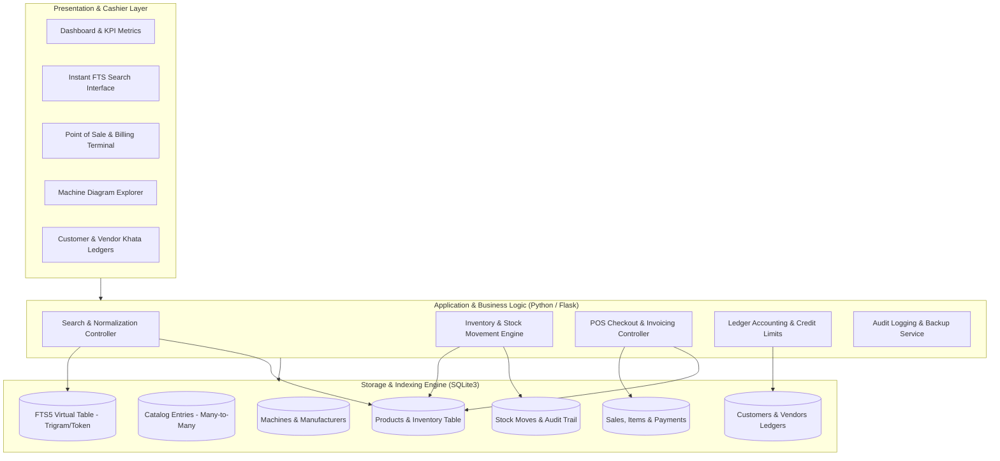

### Relational Schema Design
```
┌─────────────────┐       ┌────────────────────┐       ┌─────────────────┐
│  manufacturers  │1     *│      machines      │1     *│ catalog_entries │
│─────────────────├───────┼────────────────────┼───────┼─────────────────┤
│ id (PK)         │       │ id (PK)            │       │ id (PK)         │
│ name            │       │ manufacturer_id(FK)│       │ product_id (FK) ─┐
└─────────────────┘       │ model              │       │ machine_id (FK) ││
                          └────────────────────┘       │ ref_number      ││
                                                       │ section         ││
                                                       │ pdf_page        ││
                                                       └─────────────────┘│
                                                                          │
┌─────────────────┐       ┌────────────────────┐                          │
│     vendors     │1     *│      products      │*                        1│
│─────────────────├───────┼────────────────────┼──────────────────────────┘
│ id (PK)         │       │ id (PK)            │
│ name            │       │ part_code          │       ┌─────────────────┐
│ phone           │       │ code_key (Indexed) │1     *│   sale_items    │
│ opening_balance │       │ custom_name        │───────┼─────────────────┤
└─────────────────┘       │ stock_qty, min_lvl │       │ id (PK)         │
                          │ purchase/sale_price│       │ sale_id (FK)    │
                          │ rack location      │       │ product_id (FK) │
                          └────────────────────┘       │ qty, price, cost│
                                     │1                └─────────────────┘
                                     │                          │*
                                     │*                         │1
                          ┌────────────────────┐       ┌─────────────────┐
                          │    stock_moves     │       │      sales      │
                          │────────────────────│       │─────────────────┤
                          │ id (PK)            │       │ id (PK)         │
                          │ product_id (FK)    │       │ invoice_no      │
                          │ qty_change, kind   │       │ customer_id(FK) │
                          │ unit_cost, date    │       │ subtotal, total │
                          └────────────────────┘       └─────────────────┘
```

---

## 🔄 Operational Workflows

### 1. Point of Sale & Checkout Workflow
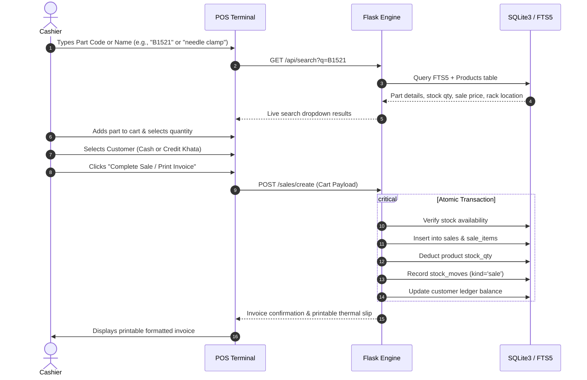

### 2. Stock Inward & Vendor Khata Workflow
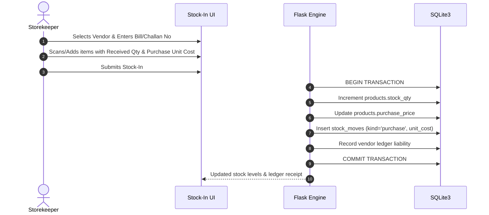

---

## 💻 Technology Stack

| Domain | Technology | Implementation Details |
| :--- | :--- | :--- |
| **Backend Framework** | **Python 3.12 / Flask** | Lightweight, high-throughput REST controllers and Jinja2 server-side rendering |
| **Database & Search** | **SQLite3 + FTS5** | Serverless relational engine with ACID transactions, foreign keys, and Full-Text Search virtual tables |
| **Search Normalization** | **Regex & Trigram Tokenizers** | Strips special characters (`-`, `/`, `.`, spaces) to enable instant lookup regardless of user input style |
| **Frontend & UI/UX** | **HTML5, CSS3, Vanilla JS (ES6+)** | Responsive cashier POS interface, dynamic client-side cart calculations, modal workflows, printable CSS |
| **Packaging & Distribution**| **PyInstaller & Inno Setup** | Compiled into a single zero-configuration Windows desktop installer (`.exe`) with desktop shortcuts |
| **Data Processing & ETL** | **Python Extraction Pipeline** | Automated parser reconciling 41 machine PDF parts manuals into a structured relational catalog |
| **Security & Licensing** | **Hardware Node-Locking** | Machine-fingerprinted license activation system for enterprise deployments |

---

## 👨‍💻 Engineering Role & Contributions

As the **Lead Software Engineer and Architect**, my responsibilities spanned end-to-end design and execution:

1. **Domain Data Engineering**:
   - Engineered data ingestion scripts to clean, normalize, and ingest 76,000+ catalog rows across 41 industrial machine manuals.
   - Built heuristic noise-filtering algorithms to discard OCR anomalies while preserving valid multi-manufacturer part codes.
2. **Database & Query Optimization**:
   - Designed the relational schema with many-to-many joins, ensuring physical inventory bins remained unified while preserving machine-specific subassembly mappings.
   - Configured SQLite FTS5 with synchronized triggers to guarantee sub-millisecond search across 25,000+ parts.
3. **Full-Stack Application Development**:
   - Built the Flask backend services handling POS transactions, inventory deduction, credit limit validations, and stock movement auditing.
   - Crafted a keyboard-friendly, rapid POS interface in vanilla JavaScript without heavy framework overhead to maximize responsiveness on shop-floor hardware.
4. **Desktop Packaging & Windows Deployment**:
   - Structured the application for native Windows deployment using PyInstaller, bundled assets, embedded database paths, and Inno Setup script creation.
   - Created node-locked machine activation mechanics to secure the production software.

---

## 📸 Screenshots & Visual Walkthrough

> *All screenshots below showcase real interfaces populated with sanitized catalog and demo transactional data.*

### 1. Central Executive Dashboard
*Real-time business overview with active stock stats, fast shortcuts, low stock alerts, and quick inventory lookup.*
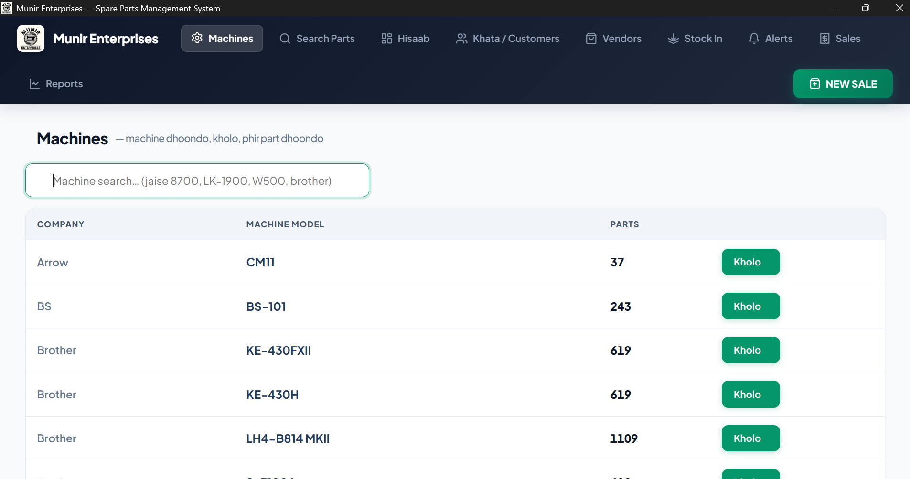

---

### 2. High-Speed Catalog & Inventory Search
*Instant full-text search across 25,000+ parts with compatibility previews, rack locations, and real-time stock indicators.*
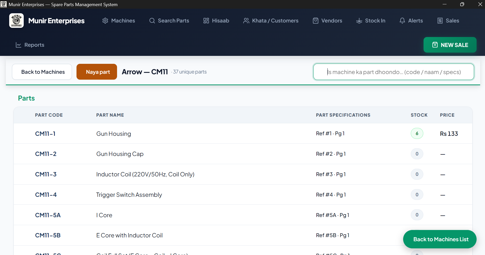

---

### 3. Machine Catalog & Sub-Assembly Explorer
*Browsing industrial machines by manufacturer and model with complete exploded part breakdowns.*
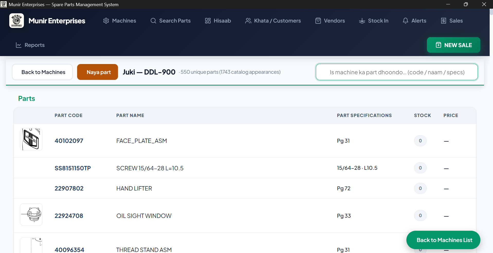

---

### 4. Part Detail & Cross-Machine Compatibility
*Comprehensive view of a single part showing pricing, rack location, and every compatible machine model.*
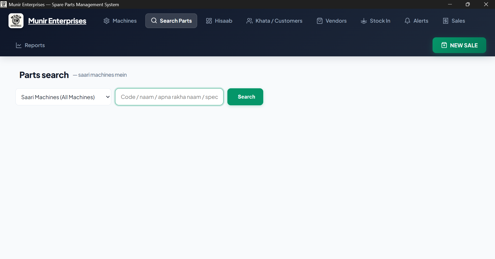

---

### 5. Point of Sale (POS) Cashier Terminal
*Rapid billing interface with dynamic cart calculation, split payments, instant customer Khata link, and stock deduction.*
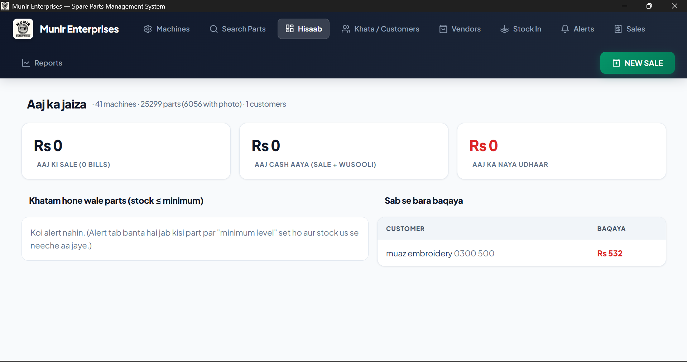

---

### 6. Sales Invoices & Order Management
*Searchable invoice registry with status tracking, payment breakdowns, and thermal print actions.*
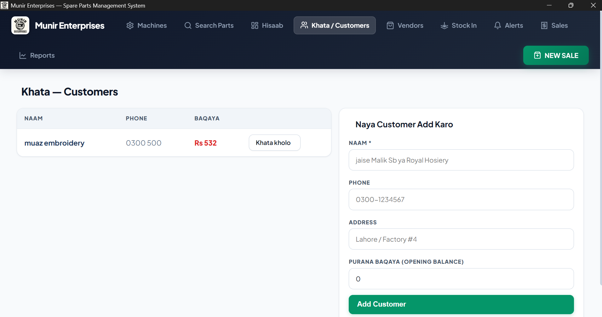

---

### 7. Inventory Receiving & Stock-In
*Batch stock intake interface with vendor assignment, cost recording, and automatic stock level updates.*
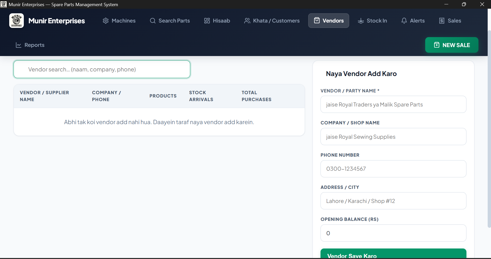

---

### 8. Customer Khata & Credit Accounts
*Customer balance ledger tracking total receivables, credit allowances, and complete transaction histories.*
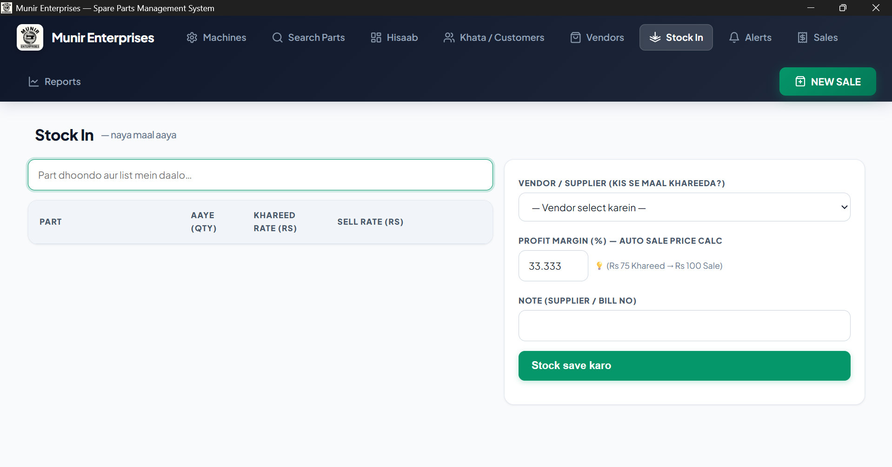

---

### 9. Vendor Procurement & Ledger
*Supplier account management recording inventory purchase consignments and payable balances.*
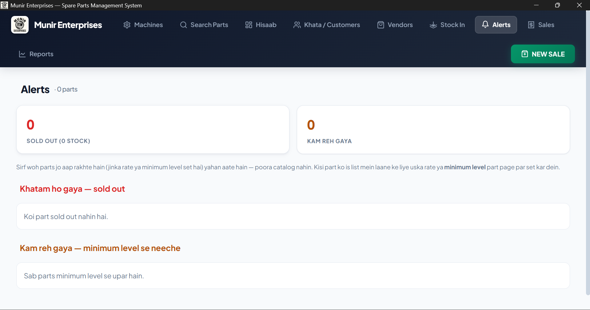

---

## 🚀 Project Status

- **Status**: **Completed & Deployed in Production**
- **Deployment**: Live in commercial industrial machinery spare parts distribution store.
- **Maintenance**: Active operational support with automated local backup routines.

---

## 🔒 Privacy & Proprietary Source Notice

> **Note on Source Code Availability:**  
> This repository serves as a **public portfolio case study and architectural overview** of the Spare Parts Management & Sales System.  
> 
> The underlying source code, database implementations, and proprietary business datasets are private commercial assets and are **not publicly distributed**. For inquiries regarding architecture, engineering patterns, or technical consultations, please contact the author directly.

---

## 📬 Contact & Links

- **Developer**: Abdul Nafay
- **Project Role**: Full-Stack System Architect & Developer
- **Focus Areas**: Desktop Systems, Relational Database Engineering, FTS5 Search Optimization, POS Systems
